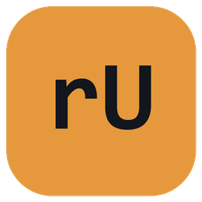

<p align="center">
  
</p>

<h1 align="center">rUNOdeck</h1>

<p align="center">
  Open-source DIY Arduino Macro Controller, Analog Thumbstick Navigator, and Zero-Latency Windows CoreAudio Switcher with a Desktop Companion GUI.
</p>

---

## Overview

**rUNOdeck** turns an Arduino Uno (or Nano), a 4x4 matrix keypad, an analog 2-axis thumbstick, and a 16x2 I2C character LCD into a customizable desktop macro instrument for Windows.

Unlike boards that require native USB HID hardware, rUNOdeck communicates over a high-speed `115200` baud serial bridge to a lightweight background companion app (`runodeck.pyw`). This allows any standard Arduino board to trigger complex keyboard shortcuts, launch applications, move the cursor proportionally, smooth-scroll code and webpages, and switch Windows default audio playback devices without opening command windows.

---

## Features

- **16-Key Tactile Matrix + `*` Chord Layer**: Trigger direct hotkeys, URLs, media transport controls, text snippets, audio device switches, or application launches. Pressing `*` enters a secondary chord menu (`* + 0` through `* + D`), and any custom label configured in the GUI is dynamically displayed on the physical 16x2 LCD when triggered.
- **3 Live Analog Joystick Modes (Cycled via Stick Push-Button `SW`)**:
  - **Mode 1 (`Shortcuts`)**: Push and hold Up/Down for variable-speed continuous actions (`140ms` down to `45ms` repeat interval based on stick tilt), or flick Left/Right for instant shortcuts. All 4 directions (`UP`, `DOWN`, `LEFT`, `RIGHT`) are customizable in the GUI.
  - **Mode 2 (`Mouse`)**: 62Hz EMA low-pass filtered vector streaming paired with a Win32 sub-pixel accumulator and quadratic acceleration curve for jitter-free cursor precision.
  - **Mode 3 (`Scroll`)**: 40Hz proportional wheel-delta scrolling for smooth document and webpage navigation.
  - **Hardware Center Calibration & Live Telemetry**: Streams normalized deflection vectors (`TELEM: x,y`) in all modes with one-click hardware zero-point calibration from the desktop GUI, plus bi-directional `SW` switch sensing (`GND` and `+5V` polarity auto-detection).
- **Silent Windows CoreAudio Switching**: Includes a standalone C# COM interop utility (`SetAudioDevice.cs`) targeting the Windows `IPolicyConfig` vtable to switch Console, Multimedia, and Communications audio endpoints (`*` + `4` for Speakers, `*` + `5` for Headphones, `*` + `C` for Earphone Jack) silently in the background.
- **Custom CGRAM LCD HUD, Idle Wave Animation & Stealth Mode**: Features a custom infinity badge and a non-blocking 16-column equalizer wave animation after 5 seconds of inactivity, plus a hardware/software chord (`*` + `0`) to turn the LCD backlight off or on.
- **Frameless Desktop Companion GUI & System Tray**:
  - Built with `pywebview` (Edge WebView2) and `pystray` with a custom frameless window bar and adaptive layout.
  - Real-time visual highlight and live 16x2 LCD preview when physical keys or chords are pressed on the hardware.
  - Live XY analog joystick telemetry radar and interactive shortcut keycap chips.
  - Light and Dark color schemes with persistent JSON configuration (`runodeck_config.json`).
  - Minimizes to the Windows System Tray with one-click Pause/Resume.

---

## Hardware Bill of Materials & Pinout

### Components
- **Microcontroller**: Arduino Uno R3 or Arduino Nano (ATmega328P)
- **Display**: 16x2 Character LCD (HD44780) with PCF8574 I2C backpack (`0x27` address)
- **Keypad**: 4x4 16-Button Matrix Module
- **Joystick**: Dual-axis KY-023 Analog Joystick Module with push-button switch

### Wiring Pinout

| Component | Module Pin | Arduino Pin | Notes |
| :--- | :--- | :--- | :--- |
| **16x2 I2C LCD** | `GND` | `GND` | Common ground |
| | `VCC` | `5V` | 5V rail |
| | `SDA` | `A4` (or `SDA`) | I2C Data |
| | `SCL` | `A5` (or `SCL`) | I2C Clock |
| **4x4 Keypad** | `R1, R2, R3, R4` | `D2, D3, D4, D5` | Row pins |
| | `C1, C2, C3, C4` | `D6, D7, D8, D9` | Column pins |
| **Analog Joystick** | `GND` | `GND` | Common ground |
| | `+5V` | `5V` | 5V rail |
| | `VRx` | `A0` | Horizontal analog axis |
| | `VRy` | `A1` | Vertical analog axis |
| | `SW` | `A2` | Push-button (`INPUT_PULLUP`) |

---

## Installation & Setup

### 1. Flash the Arduino Firmware
1. Open [`rUNOdeck.ino`](rUNOdeck.ino) in the Arduino IDE.
2. Install the following libraries from the Arduino Library Manager:
   - `LiquidCrystal I2C` (by Frank de Brabander)
   - `Keypad` (by Mark Stanley, Alexander Brevig)
3. Select your Arduino board and COM port, then click **Upload**.

### 2. Install Python Dependencies
Ensure Python 3.10+ is installed on Windows, then run:

```bash
pip install -r requirements.txt
```

### 3. Compile the Silent Audio Switcher (Optional Rebuild)
`SetAudioDevice.exe` comes pre-configured to build with the built-in Windows .NET Framework C# compiler (`csc.exe`):

```powershell
& "C:\Windows\Microsoft.NET\Framework64\v4.0.30319\csc.exe" /target:winexe /platform:x64 /out:SetAudioDevice.exe SetAudioDevice.cs
```

### 4. Run rUNOdeck
Launch the companion app without a console window:

```powershell
pythonw runodeck.pyw
```

---

## Project Structure

```text
rUNOdeck/
├── gui/
│   ├── index.html          # Desktop UI (Keypad matrix, Combos, Audio endpoints, Joystick radar)
│   └── logo.png            # Application artwork
├── rUNOdeck.ino            # Arduino firmware (Keypad scanning, LCD menu, 3-mode joystick)
├── runodeck.pyw            # Background serial listener, System Tray, and PyWebView bridge
├── runodeck_config.json    # Persistent key & chord bindings
├── runodeck.ico            # Multi-resolution Windows icon
├── SetAudioDevice.cs       # Native Windows CoreAudio IPolicyConfig endpoint switcher source
├── SetAudioDevice.exe      # Compiled windowless audio switcher binary
├── DESIGN.md               # Visual design direction and accessibility specification
├── requirements.txt        # Python package dependencies
└── LICENSE                 # MIT License
```

---

## License

Released under the [MIT License](LICENSE).
